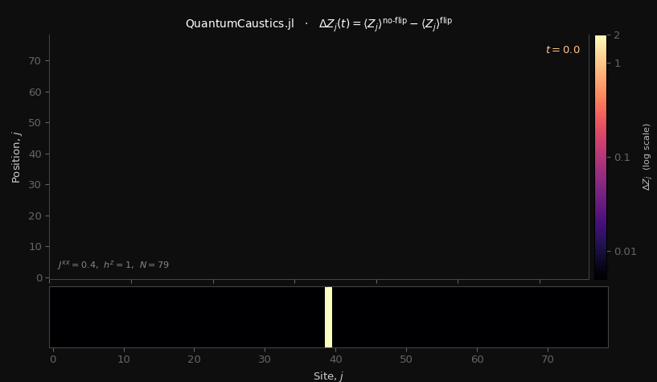

# QuantumCaustics.jl

Published paper: [Physical Review A 114, 022201 (2026)](https://journals.aps.org/pra/abstract/10.1103/zxz5-9ghf). arXiv: [2410.06803](https://arxiv.org/abs/2410.06803).

## Introduction

Better batteries, new materials, and new medicines depend on how large but finite groups of quantum particles behave together. How they change in time is the subject of "many-body quantum dynamics". In a battery electrode or a drug molecule, these particles are electrons and atomic nuclei, which interact with each other and obey quantum mechanics. The simplest such particle is a spin, or qubit, which has two states, written 0 and 1, and can also be in a superposition of both. We study a chain of spins that all start in the same state, with the spin at the centre flipped. As time passes, the spins act on each other and the state of the chain changes, which is called "time evolution". The flip then spreads along the chain as a wave in the magnetisation (the average spin along z-axis).


*Left: a caustic cast by a glass of water. Right: the same focusing reproduced in a quantum spin chain, the light cone of magnetisation after a single spin flip at the centre, position against time. This package produces the right-hand panel.*



*Colour scale: magma, log scale, ΔZ ∈ [0, 2]. The central spin is flipped at t = 0 and the caustic fringes propagate outward at the Lieb-Robinson velocity v = 2Jxx, consistent with the 2/3 power law of an Airy fold expected throughout the paramagnetic phase.*

At the front of the wave, the magnetisation focuses into a sharp edge, a "caustic", dressed with repeating bright and dark bands called fringes. The bright lines that light makes beside a glass of water, or on a swimming pool floor, are caustics of light. Catastrophe theory classifies such patterns. The simplest is the fold, whose wave pattern is the Airy function, so it is called the Airy fold. At one site, the first two fringes arrive at times t<sub>1</sub> and t<sub>2</sub> after the flip, and we call (t<sub>2</sub> − t<sub>1</sub>)/t<sub>1</sub> the normalised delay. For the Airy fold, the normalised delay is proportional to d<sup>−2/3</sup>, where d is the distance from the flip. The exponent departs from the value 2/3 near the phase transition between the disordered and the ordered phase, so these caustics fringes also mark that transition.

Computing this pattern for many spins is hard. The state of N spins takes 2<sup>N</sup> complex numbers, one amplitude for each of the 2<sup>N</sup> ways the spins can point up or down. That is about a million numbers for 20 spins, and about a trillion for 40, near 18 terabytes at 16 bytes per number. Each added spin doubles the count, and each time step acts on all of them. An exact calculation that stores the state runs out of memory near 28 spins on a laptop. Useful quantum applications involve hundreds of spins. A quantum computer would run the evolution directly, but present-day machines are small and error-prone, and for now their noise dominates the result. Beyond a few dozen qubits, an exact calculation cannot check what such a machine returns.

Many states of interest have far less entanglement, the quantum correlation between parts of a chain, than a generic state. A weakly entangled state can be written with far fewer than 2<sup>N</sup> numbers. A tensor network writes the state as a chain of small tensors. Its bond dimension, the size of the links between them, caps how much entanglement it keeps. For a chain, this tensor network is a matrix product state (MPS). We use the density matrix renormalisation group (DMRG) to find ground states as MPS, and time-evolving block decimation (TEBD) to evolve an MPS in time. Together they simulate hundreds of interacting spins on an ordinary computer.

This package applies TEBD to the flipped chain. It computes the magnetisation of every spin and the half-chain entanglement entropy at every time step. It also produces the colour map in which the caustic appears. The magnetisation is the input for fitting the exponent of the normalised delay. Every run can be checked against a full exact calculation on small chains, which validates the tensor-network evolution where an exact calculation is possible.

We propose a first check of a quantum computer: flip one qubit in a chain, apply its interactions step by step, and look for the fringes. In the simulations of the paper, a weak extra interaction between neighbouring spins keeps the fringes, and a strong one removes them. On a device that implements the chain as intended, the fringes should appear, and this package computes the expected pattern to compare with.

The tensor network reaches several hundred spins, up to 301 in the arXiv version of the paper; the colour map above is a 79-spin run. The package produced the calculations in Singh Roy et al. (Physical Review A 114, 022201, 2026; arXiv:2410.06803), regenerable from a clean checkout. A coauthor reproduced them independently in Python, the cross-check cited there. It is also a base for further work on how quantum systems evolve and how measurement alters them. A first run on 21 spins takes a few minutes on a laptop, as set out under [Run it](#run-it).

## The model and its phases

In the transverse-field Ising model, Eq. 1 of the paper, each spin is coupled to its nearest neighbours and acted on by a transverse field,

H = −Jxx Σ<sub>j</sub> X<sub>j</sub> X<sub>j+1</sub> − hz Σ<sub>j</sub> Z<sub>j</sub>,

where X<sub>j</sub> and Z<sub>j</sub> are the Pauli operators on site j. An optional coupling adds −Jzz Σ<sub>j</sub> Z<sub>j</sub> Z<sub>j+1</sub> (Eq. 23 in the paper), which breaks the integrability of the model, that is, makes it no longer exactly solvable. Jxx is the spin-spin coupling, hz the transverse field, and Jzz is zero in the pure model and small when the scaling is tested against integrability breaking. For Jzz = 0, the transition of an infinite chain occurs at Jxx = hz. Thus, the ratio Jxx/hz determines the phase: below 1 the chain is paramagnetic, the disordered phase in which the field dominates, and above 1 it is ferromagnetic, the ordered phase in which the coupling dominates. The phase can also be read off from the caustic pattern.

After the central spin flip, a checkerboard-like pattern of fringes spreads outward in position and time, inside a light cone whose edge moves at the Lieb-Robinson velocity, the maximum speed at which a local change spreads along the chain. The normalised delay between the first two fringes scales as a power of the distance. In the paramagnetic phase the caustic is an Airy fold, whose exponent has the universal value 2/3. The exponent deviates from 2/3 once Jxx/hz approaches 1, the phase transition point. The caustic pattern and the 2/3 scaling also survive a weak integrability-breaking perturbation Jzz, but the caustic is lost as Jzz grows. The four regimes, the two phases and weak and strong integrability breaking, are the committed problem instances in problems/, described under "Problem instances" below.

## Install

You need Julia 1.10 or later and git. If you do not have them, install Julia from the Julia website (julialang.org) and git from git-scm.com.

Clone the repository and install everything it needs:

```bash
git clone https://github.com/monalisasroy/QuantumCaustics.jl.git
cd QuantumCaustics.jl
julia --project=. -e 'using Pkg; Pkg.instantiate()'
```

The dependencies and their resolved versions are recorded in Project.toml and the committed Manifest.toml, so this one command installs them all, with nothing added by hand. To confirm the install, run the tests:

```bash
julia --project=. -e 'using Pkg; Pkg.test()'
```

## Run it

The quickest reproducible run is a named problem instance. This evolves the paramagnetic chain of the paper at its full size and writes the two observables into results/, with their figures in results/figures/:

```bash
julia --project=. run.jl --problem tfim_paramagnetic
```

For a faster first look, a small chain set by flags finishes in a few minutes on a laptop:

```bash
julia --project=. run.jl --N 21 --Jxx 0.5 --hz 1.0 --T 30 --output-dir results/
```

Either way, open the `dZ_*.png` it writes to results/figures/: the light cone and its fringe pattern after a single spin flip at the centre. The matching `Z_*.png` is the raw magnetisation, where the boundary's reversed cone is visible.

## Problem instances

The regimes of the paper are committed as named parameter files in problems/, so a result is reproduced by name rather than by retyping flags. Each is read like a parameter file and run with one command, either for a single instance or for all of them:

```bash
julia --project=. run.jl --problem tfim_paramagnetic
julia --project=. run.jl --problem all
```

Each instance writes two observables into results/ as a .txt, with a matching .png in results/figures/: the raw magnetisation `Z_<tag>`, the measured light cone in which the boundary's reversed cone is visible, and the subtracted caustic `dZ_<tag>`, in which the boundary cancels and the 2/3 scaling can be read. The instances are:

| instance | parameters | what it shows |
|---|---|---|
| `tfim_paramagnetic` | `Jxx = 0.5`, `hz = 1.0` | the universal 2/3 caustic (Figs 2, 3a) |
| `tfim_ferromagnetic` | `Jxx = 1.5`, `hz = 1.0` | the exponent departs from 2/3 (Fig 4a) |
| `tfim_paramagnetic_jzz_weak` | `Jxx = 0.5`, `hz = 1.0`, `Jzz = 0.2` | the caustic survives weak breaking (Fig 4b) |
| `tfim_paramagnetic_jzz_strong` | `Jxx = 0.5`, `hz = 1.0`, `Jzz = 0.4` | the caustic degrades |

The naming is `tfim_<phase>`, with an optional `_jzz_<strength>`; a new instance is one small file in problems/. These run at the paper's size, N = 79, so they take longer than the small run above.

## Setting parameters

Parameters come from one of three places:

- src/parameters.jl holds the default for every parameter, each a named constant in one file. Edit a constant there to change the default for every run.
- Command-line flags override those defaults for a single run or sweep.
- A problem instance in problems/ sets them from a named file, the reproducible way, run with --problem NAME.

Whichever is used, each run logs the parameters it resolved, with the centre site, the step count, and the phase, as a double-check before it computes.

## Worked example

Used from the Julia prompt (the REPL), the package is the interactive path the Julia workflow recommends: import it once, then call it, which pays the compilation latency a single time rather than on every script start.

```julia
using QuantumCaustics
spec = TransverseFieldIsing(; Jxx = 0.5, hz = 1.0, boundary = OPEN)
res  = caustic_difference(spec; N = 21, dt = 0.1, ttotal = 30.0)
write_caustic(res, "results")   # data .txt in results/, figures .png in results/figures/

# validate the same setup against the exact engine at small N
cmp = compare_caustic(spec; N = 9, dt = 0.1, ttotal = 10.0)
@show cmp.dZmax cmp.dZmean cmp.dSmax
```

On a laptop this produces a 21-spin run in a few minutes, a small version of figure 2. The result holds the raw magnetisation of every spin and the half-chain entanglement, both at every time step. The magnetisation is the input any scaling analysis reads.

## What this computes

- The raw magnetisation ⟨Z<sub>j</sub>(t)⟩ after the central spin flip, the measured light cone, and its subtraction ΔZ of Eq. 22, the magnetisation with the central spin flipped minus that of the same chain without the flip, where the caustic appears with the boundary cancelled.
- The half-chain entanglement entropy that the convergence study in Appendix A reports.
- Validation of the evolution against the exact engine at small N, in both the magnetisation and the entanglement, run by the test suite.

The two observables, the raw magnetisation and ΔZ, are the inputs any downstream analysis reads. The order parameter O<sub>1,2</sub>, the normalised delay between the first two fringes at a fixed site, and the power-law fit of its exponent against distance follow from the ΔZ data a run writes; this version produces the evolution, the measurements, and the caustic, and leaves the fit to the reader.

## Method

A structured walk-through of the method, the conventions, and the convergence controls is in docs/implementation_plan.md, written for a reader meeting matrix product states for the first time.

## Command line and sweeps

Beyond the named instances, every parameter flag takes one or more values, and the run repeats for each combination, so a sweep is one command. Each run writes both observables as data in the output directory, with matching figures in its figures/ subdirectory, `Z_<tag>` and `dZ_<tag>`. The first command below is one run, and the second sweeps Jxx across the transition, one run per value, into one directory. The flag --maxdim sets the bond dimension, the cap on the entanglement the tensor network keeps, and larger chains and regimes near the transition need a larger value and take longer.

```bash
julia --project=. run.jl --N 79 --Jxx 0.5 --hz 1.0 --T 40 --maxdim 256 --output-dir results/
julia --project=. run.jl --N 79 --Jxx 0.4 0.6 0.8 1.0 1.2 --hz 1.0 --output-dir results/sweep
```

A long sweep can be detached and stopped from the shell:

```bash
nohup julia --project=. run.jl --N 79 --Jxx 0.4 0.6 0.8 1.0 1.2 1.4 --hz 1.0 \
  --T 100 --output-dir results/sweep > sweep.log 2>&1 & echo $! > sweep.pid
tail -f sweep.log
kill "$(cat sweep.pid)" 2>/dev/null
```

## Validating against the exact engine

The exact engine is part of the package, and the test suite runs it on every change. At small N it evolves the same chain on a full statevector under the same brickwall of alternating two-spin gates that the MPS applies, with no truncation, and checks the MPS against it, which pins the operator factor and the Hamiltonian sign. The statevector holds 2<sup>N</sup> amplitudes, so this engine reaches about 28 spins, where the MPS reaches several hundred. A dense propagator supplies the true dynamics exp(−iH dt) at small N, the reference that separates the Trotter error, which comes from splitting each time step into gates, from the MPS truncation, the information dropped to keep the bond dimension within its cap. Against the statevector brickwall the MPS agrees to truncation, which at small N is none; against the true dynamics it converges as dt decreases. The same checks are available from the REPL.

```julia
spec = TransverseFieldIsing(; Jxx = 0.5, hz = 1.0)
cmp  = compare_caustic(spec; N = 9, dt = 0.05, ttotal = 8.0)
cmp.dZmax   # difference from the exact statevector brickwall, truncation only
cmp.dSmax   # the same, in the half-chain entanglement
prop = exact_propagator(spec; N = 9, dt = 0.05, ttotal = 8.0)   # true dynamics exp(-iHdt)
```

## Layout

```
QuantumCaustics/
  Project.toml            manifest; dependencies resolved on install
  run.jl                  CLI entry point to the library
  README.md               context, usage, method, conventions, and results
  LICENSE  CITATION.cff   Apache 2.0 licence; software and paper citation
  docs/                   arXiv preprint, the method walk-through notes
  references.bib          contains citation-key
  src/                    core functions and utilities
  test/                   runtests.jl, including the exact-engine cross-checks
  notebooks/              caustics_tfim.ipynb, an example notebook illustrating the package
  problems/               tfim_*.toml, the paper's regimes as parameter instances
  results/                runtime outputs (data here, figures in results/figures/), outside the source tree
```

## Citation

This package is the implementation behind the calculations in Singh Roy et al., "Universal scaling of quantum caustics in the dynamics of interacting particles" (Physical Review A 114, 022201, 2026; arXiv:2410.06803). The results were independently reproduced in Python by a coauthor as part of their project; that reproduction is cited in the current manuscript and is an independent cross-check. Cite the software through CITATION.cff and the paper through the entry in references.bib.

The package is also the base for the author's continuing work on quantum dynamics and measurement-induced transitions in these systems.

## Status and caveats

The package provides the evolution, the measurements, the two observables (the raw magnetisation and the subtracted caustic ΔZ), and the exact-engine cross-checks (the statevector brickwall and the dense propagator). The power-law fit that turns the caustic into the scaling exponent can be computed from these. In the paper the fitted exponent converges near 0.68, close to the theoretical 2/3, and a fully universal finite-size scaling was not reached. The check of a quantum computer proposed in the Introduction has not been run on hardware.

## Licence

Apache 2.0. Copyright 2026 Monalisa Singh Roy. See LICENSE. The software citation is in CITATION.cff and the paper in references.bib.
